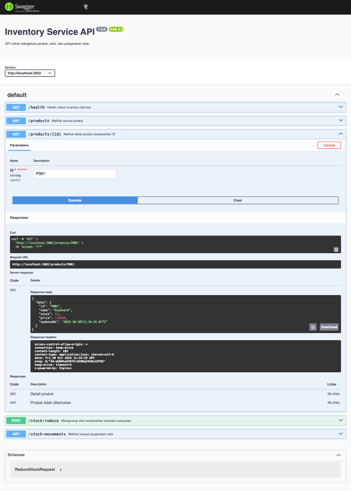
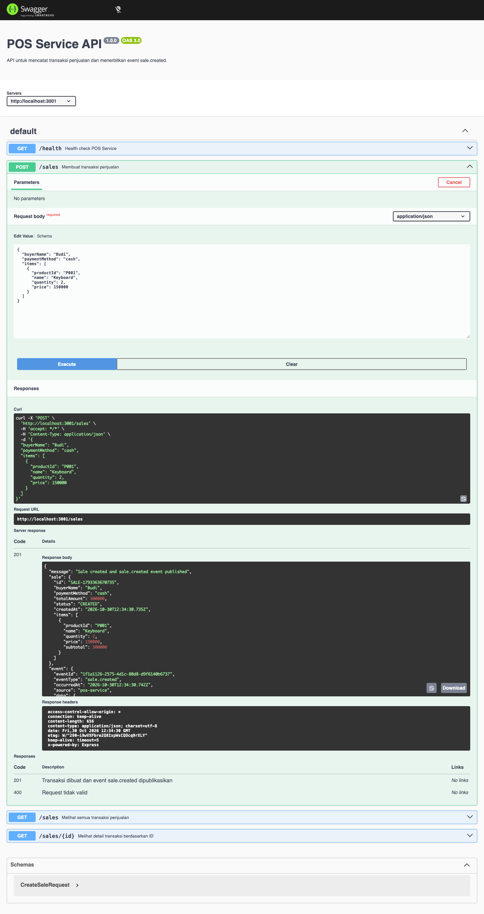
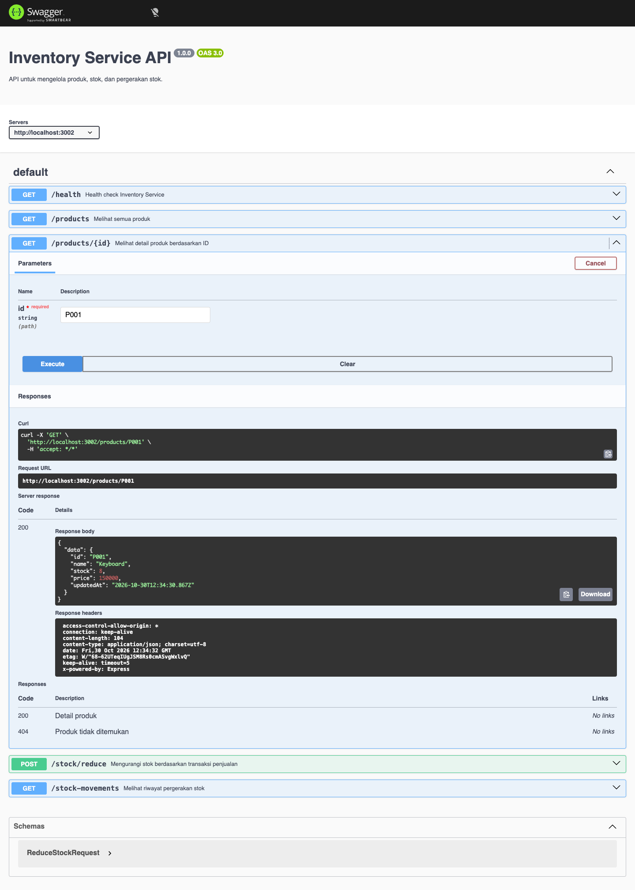
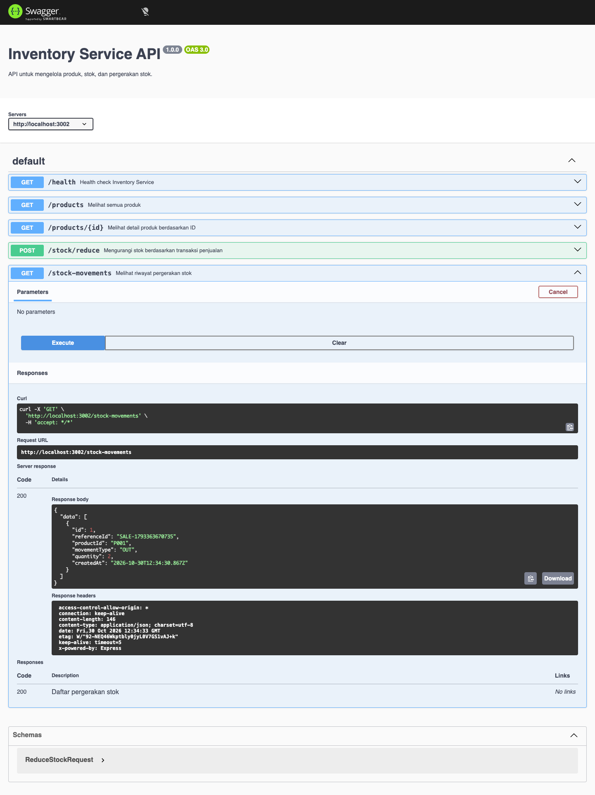
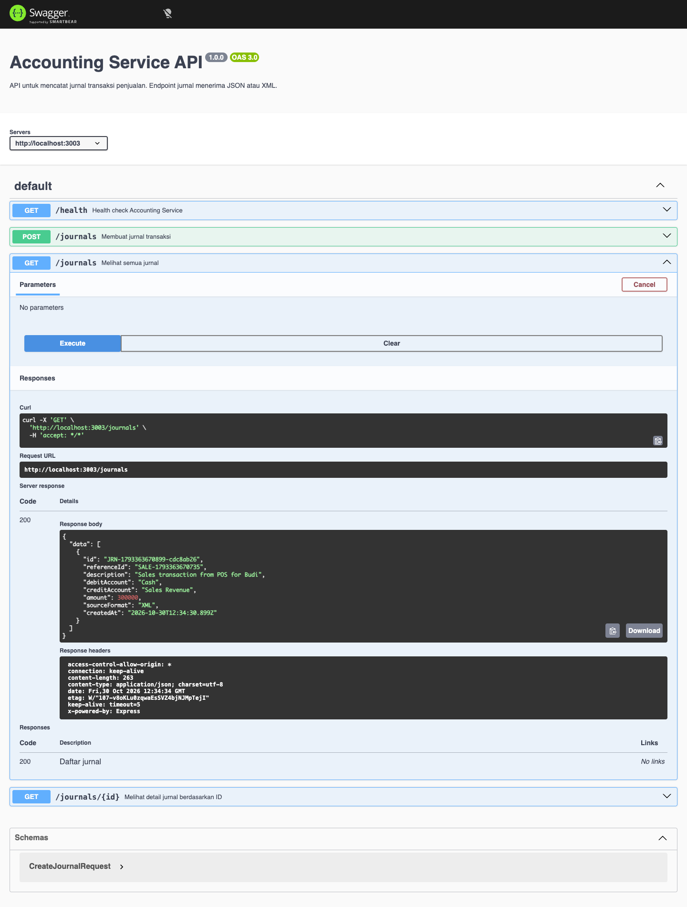
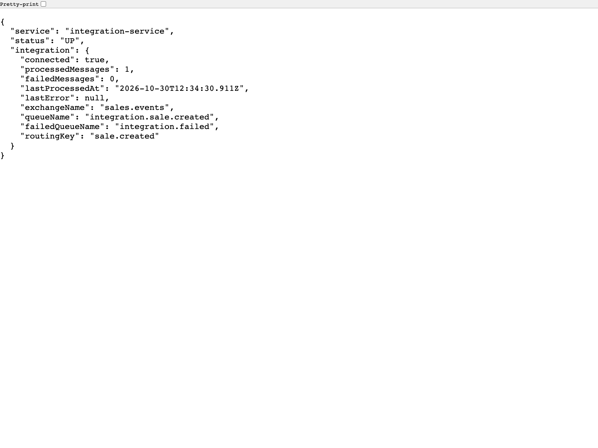
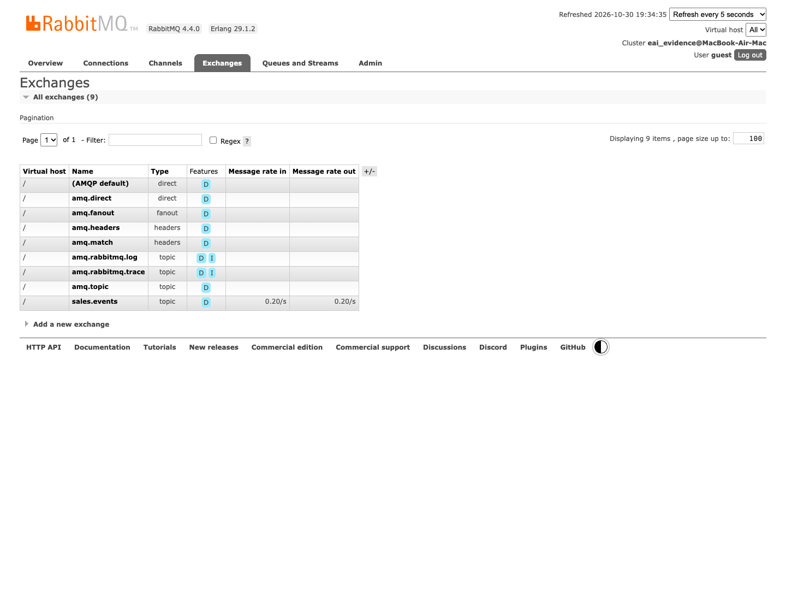
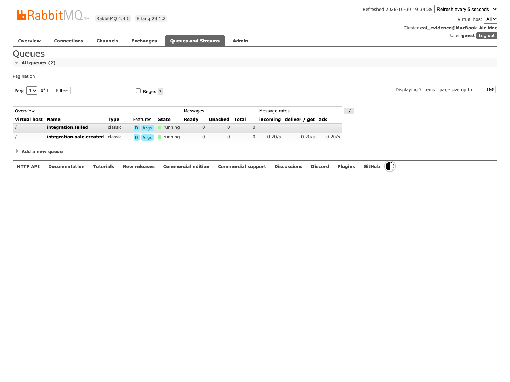
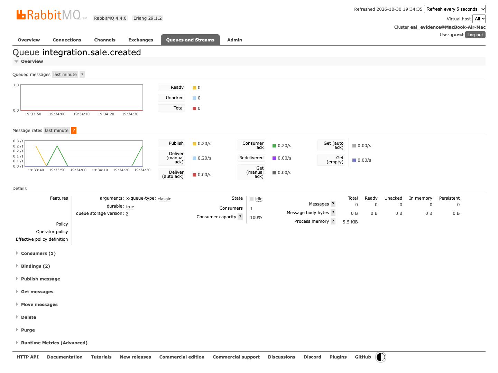

# Dokumentasi Pengujian Integrasi Retail

Pengujian menggunakan satu transaksi POS untuk produk `P001` (Keyboard), jumlah dua unit, harga satuan Rp150.000. Total transaksi Rp300.000. Keberhasilan diperiksa melalui ID transaksi yang sama pada POS, stock movement Inventory, dan jurnal Accounting.

## Lingkungan dan Cara Verifikasi

Pengujian dijalankan secara lokal pada macOS menggunakan Node.js, SQLite, dan RabbitMQ asli. Screenshot diambil dari Swagger UI, endpoint health, dan RabbitMQ Management melalui Chrome. Docker belum tersedia pada mesin pengujian; screenshot ini membuktikan alur aplikasi lokal, belum memverifikasi build dan runtime Docker Compose.

Respons mentah beserta waktu pengambilan, versi Node.js, dan ID transaksi tersedia di [hasil-pengujian.json](hasil-pengujian.json). Angka stok pada pengujian ini berasal dari database uji baru. Pada database yang sudah digunakan, bandingkan stok sebelum dan sesudah transaksi; nilainya dapat berbeda.

## Ringkasan Hasil

| Tahap | Hasil yang diperiksa | Bukti |
|---|---|---|
| Stok awal | `P001` memiliki stok `10` | Gambar 01 |
| Transaksi POS | HTTP `201`, event `sale.created`, total `300000` | Gambar 02 |
| Stok akhir | Stok `P001` menjadi `8` | Gambar 03 |
| Stock movement | `OUT` sebanyak `2`, referensi sesuai transaksi POS | Gambar 04 |
| Jurnal Accounting | Nilai `300000`, `sourceFormat: XML`, referensi sesuai transaksi POS | Gambar 05 |
| Integration Service | `status: UP`, `connected: true`, pesan berhasil diproses tanpa kegagalan | Gambar 06 |
| RabbitMQ exchange | Exchange `sales.events` tersedia | Gambar 07 |
| RabbitMQ queues | Queue transaksi dan queue kegagalan tersedia | Gambar 08 |
| Consumer | Consumer aktif pada `integration.sale.created` | Gambar 09 |

## 01. Stok Awal Inventory

`GET /products/P001` mengembalikan HTTP `200` dan stok awal `10`.

## 02. Transaksi POS Berhasil

`POST /sales` mengembalikan HTTP `201` dengan pesan `Sale created and sale.created event published`. Respons menampilkan transaksi dan event JSON. Response ini membuktikan langkah POS; penyelesaian integrasi diperiksa terpisah pada Inventory dan Accounting.

## 03. Stok Inventory Berkurang

Setelah event diproses, `GET /products/P001` mengembalikan stok `8`. Selisih dua unit sesuai jumlah pembelian. Pengujian tidak memanggil `POST /stock/reduce` secara manual; pengurangan dipicu Integration Service.

## 04. Riwayat Pergerakan Stok

`GET /stock-movements` menampilkan `movementType: OUT`, `quantity: 2`, dan `referenceId` yang sama dengan ID transaksi POS.

## 05. Jurnal Accounting dari XML

`GET /journals` menampilkan jurnal Rp300.000. `sourceFormat: XML` menunjukkan payload hasil transformasi diterima Accounting sebagai XML. Referensi jurnal dicocokkan dengan ID transaksi POS.

## 06. Status Integration Service

`GET /health` menunjukkan consumer terhubung ke RabbitMQ dan jumlah pesan berhasil diproses. Endpoint ini harus dibaca bersama bukti perubahan stok dan jurnal.

## 07. Exchange RabbitMQ

Tab **Exchanges** menampilkan exchange `sales.events` tempat POS menerbitkan event. Nama exchange yang tersedia adalah bukti konfigurasi; keberhasilan bisnis dibuktikan oleh stok, stock movement, dan jurnal.

## 08. Queue RabbitMQ

Tab **Queues and Streams** menampilkan `integration.sale.created` dan `integration.failed`. Queue transaksi bisa berisi nol pesan karena consumer segera memproses dan mengakui pesan. Queue kosong saja tidak membuktikan keberhasilan integrasi.

## 09. Consumer Queue Aktif

Detail queue `integration.sale.created` menampilkan consumer yang berlangganan. Bukti ini melengkapi status `connected` pada Integration Service.

## Mengulang Pengambilan Bukti

Script [capture-evidence.cjs](../scripts/capture-evidence.cjs) memeriksa respons API dan mengambil screenshot. Jalankan dari root repository menggunakan `node scripts/capture-evidence.cjs` setelah menyediakan package `playwright`, Chrome, dan seluruh service. Alternatifnya, arahkan environment variable `PLAYWRIGHT_MODULE` ke lokasi package Playwright yang sudah tersedia. Script membuat satu transaksi nyata dan mensyaratkan stok awal `P001` bernilai `10`; gunakan database khusus pengujian.

Consumer juga diuji dalam kondisi RabbitMQ belum siap: koneksi awal gagal dan dijadwalkan ulang setiap lima detik, lalu tersambung setelah broker siap tanpa restart Integration Service. Pemulihan setelah koneksi yang sudah aktif terputus dan skenario gagal parsial antarservice belum dicakup pengujian ini.

Definisi respons `POST /sales` pada OpenAPI diperbaiki agar `responses` berada di dalam operasi `post`. Dengan struktur ini, Swagger menampilkan bagian **Server response** setelah transaksi dikirim.
